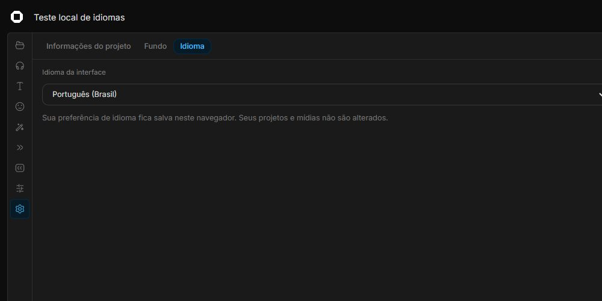
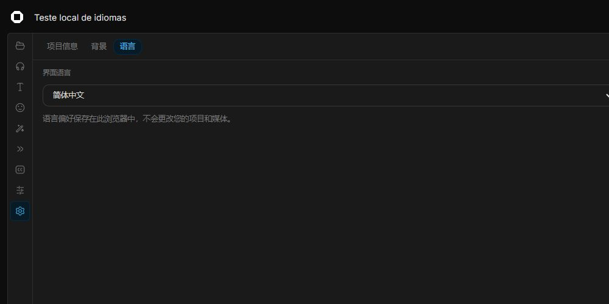

# OpenCut Classic — Community Edition

An independent fork of [OpenCut Classic](https://github.com/OpenCut-app/opencut-classic), maintained by [nexora-sudo](https://github.com/nexora-sudo), with Brazilian Portuguese, Simplified Chinese, English, Japanese and British English interface options.

**Português:** editor de vídeo com interface em português do Brasil, chinês simplificado, inglês, japonês e inglês do Reino Unido. Veja o [guia de teste local em português](LOCAL-TESTING.pt-BR.md).

This fork uses the original Classic editor. Upstream Classic is archived; the [OpenCut rewrite](https://github.com/OpenCut-app/OpenCut) is a different codebase. This is an independent community project, not an official OpenCut release.

## Community: bugs and feature ideas

This fork welcomes community bug fixes, feature proposals and translation improvements.

- [Report a bug](https://github.com/nexora-sudo/OpenCut/issues/new?template=bug_report.yml)
- [Suggest a feature](https://github.com/nexora-sudo/OpenCut/issues/new?template=feature_request.yml)
- [Correct a translation](https://github.com/nexora-sudo/OpenCut/issues/new?template=translation.yml)
- [Browse open requests](https://github.com/nexora-sudo/OpenCut/issues)
- [Contribute code or documentation](.github/CONTRIBUTING.md)

Search for existing requests before posting. Add reactions to ideas you support. Reports are reviewed by the maintainer; suggestions are not guaranteed to be implemented. See the [contribution guide](.github/CONTRIBUTING.md) for labels and the review process.

## Transition and effect fixes (v0.3.4)

Fixed a 30 fps playback/export regression where pooled decoder canvases made Dissolve show the outgoing clip unchanged and caused Slide left to stutter. Transitions now own a stable outgoing frame and track changing video pixels correctly. Effect thumbnails are clickable: apply to the selected visual clip, or to the entire project when none is selected. The preview moves to an off-screen selected clip so the result is visible immediately. Dragging still allows a custom effect range.

See the [0.3.4 validation report](docs/VALIDATION-0.3.4.md), including a reproducible 720p/30 fps test and measured before/after results. Effect thumbnail rendering is isolated from the main compositor.

## Resolutions, transitions and languages (v0.3.3)

Export offers **480p, 720p, 1080p and 1440p** with the actual output dimensions. The project aspect ratio is preserved: the selected resolution is the shorter edge for portrait videos. The project canvas and layout are not changed, and export scales the finished frame.

Select the **second of two touching video/image clips on the same track**, then open **Transitions** in the asset panel or clip properties. Choose **Dissolve** or **Slide left**, adjust the duration, or remove the transition. Changes support undo. These visual transitions use the previous clip’s final visible frame; they do not change project length, reveal trimmed footage or crossfade audio. Duration is limited to half of either adjacent clip; moving clips apart disables the transition.

**Black and white** is available in Effects, with adjustable intensity. Apply it to a clip or add an effect track. Preview and export use the same Rust GPU shader. Japanese and English (United Kingdom) are selectable in language settings.

See the [0.3.3 validation report](docs/VALIDATION-0.3.3.md) for test scope and limitations.

The community WASM build is included in `vendor/opencut-wasm`; normal local setup and Vercel builds do not need Rust. See its README for reproducible build instructions and provenance.

## Project protection and export improvements (v0.3.2)

The editor header shows whether changes are pending, saving, saved locally (with a time), or failed. Failed writes stay pending and can be retried. Exit waits for saving; use **Download backup** if browser storage fails.

**Download backup** creates a `.opencut` file containing the project and uploaded media. Library music is included when it can be downloaded. In the projects page, choose **Restore backup** to open it as a new project, including in another browser. Existing projects are not overwritten. Keep a separate copy outside browser storage. Linked online assets such as fonts/sticker resources may still require internet access. This is file-based transfer; cloud accounts and project sharing by URL are not implemented.

Export processes audio in small windows and streams the output to temporary browser disk storage when available. It reports codec/decode failures, its current stage, cancellation and stalled operations. If browser disk storage is unavailable, output falls back to memory and large exports still depend on available resources.

See the [repeatable browser checks](scripts/qa/README.md) for test scope. MP4/WebM with synthetic video audio, music, cuts, text, Blur and a shape sticker were checked on Windows Chrome. A **20-minute 160×90, 1 fps** export with audio completed; this does not establish 20-minute 4K performance or confirm the macOS/Edge reports with their original files.

## Languages

| Language                      | Locale  |
| ----------------------------- | ------- |
| Português (Brasil) — default  | `pt-BR` |
| 简体中文 — Simplified Chinese | `zh-CN` |
| English                       | `en`    |
| 日本語 — Japanese             | `ja`    |
| English (United Kingdom)      | `en-GB` |

Open the **gear icon** in the projects page or editor header, or select **Settings → Language** in the editor sidebar. Your preference is saved in this browser for future visits.

Translations cover interface labels, dialogs, shortcuts, known messages, informational pages and included release notes. Your project names, files and text remain as you entered them. External content, such as sound titles and externally supplied articles, keeps its original language. Translation corrections are welcome, especially review by native Chinese and Japanese speakers.

## Screenshots

### Português (Brasil)



### 简体中文



Screenshots show the language settings in a local test project.

## Run locally

Install [Git](https://git-scm.com/downloads), [Node.js 20.9 or newer](https://nodejs.org/) and [Bun](https://bun.sh/docs/installation). This fork was tested locally using Bun 1.3.11.

1. Clone the translated branch and install dependencies:

   ```sh
   git clone --branch feat/portuguese-chinese https://github.com/nexora-sudo/OpenCut.git
   cd OpenCut
   bun install --frozen-lockfile
   ```

2. Copy the environment template.

   **Windows PowerShell:**

   ```powershell
   Copy-Item apps/web/.env.example apps/web/.env.local
   ```

   **macOS / Linux:**

   ```sh
   cp apps/web/.env.example apps/web/.env.local
   ```

3. Generate a secret and paste the result as `BETTER_AUTH_SECRET` in `apps/web/.env.local`:

   ```sh
   bun -e "console.log(require('node:crypto').randomBytes(32).toString('hex'))"
   ```

4. Start the editor:

   ```sh
   cd apps/web
   bun run dev --hostname 127.0.0.1
   ```

5. Open [http://127.0.0.1:3000/projects](http://127.0.0.1:3000/projects) in a desktop browser. Create a project, import media and choose your interface language.

Basic local editing stores projects and media in the browser and does not require Docker, a database or Redis. Clearing browser site data can remove your local projects. Sound search, feedback and blog integrations require their own services and credentials; the example keys do not enable them. Keep `.env.local` private.

See the [original upstream README](README.upstream.md) for Docker, desktop and Rust/WASM development instructions. These additional setups were not validated as part of this translation work.

## Validation and contributions

The language switch was tested locally with a project and media on the timeline, including after a page reload. Translation tests and the application TypeScript check passed. The complete upstream test suite still has existing WASM and timeline failures; the production build passed. See the [v0.3.2 validation report](docs/VALIDATION-0.3.2.md) for scope and remaining limits.

Translation catalogs are in [`apps/web/src/i18n/messages`](apps/web/src/i18n/messages). For translation issues, include the language, affected screen and suggested wording.

## Credits and AI assistance

The original editor and its architecture were created by the [OpenCut team and contributors](https://github.com/OpenCut-app/opencut-classic). Original credit and the [MIT license](LICENSE) are preserved.

The localization system, language settings, translations, compatibility fixes and documentation in this fork were developed with AI assistance using OpenAI Codex, under the direction of **nexora-sudo**. This does not imply endorsement by OpenCut or OpenAI. AI-assisted translations may need further review.

Upstream acknowledgments, including its sponsors, are preserved in [README.upstream.md](README.upstream.md).

## License

[MIT](LICENSE).
